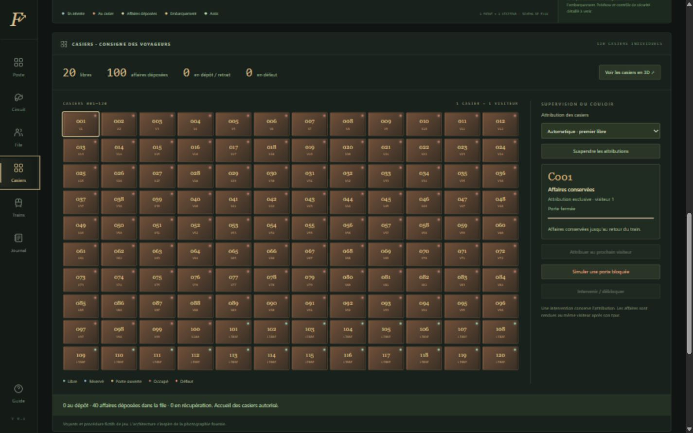
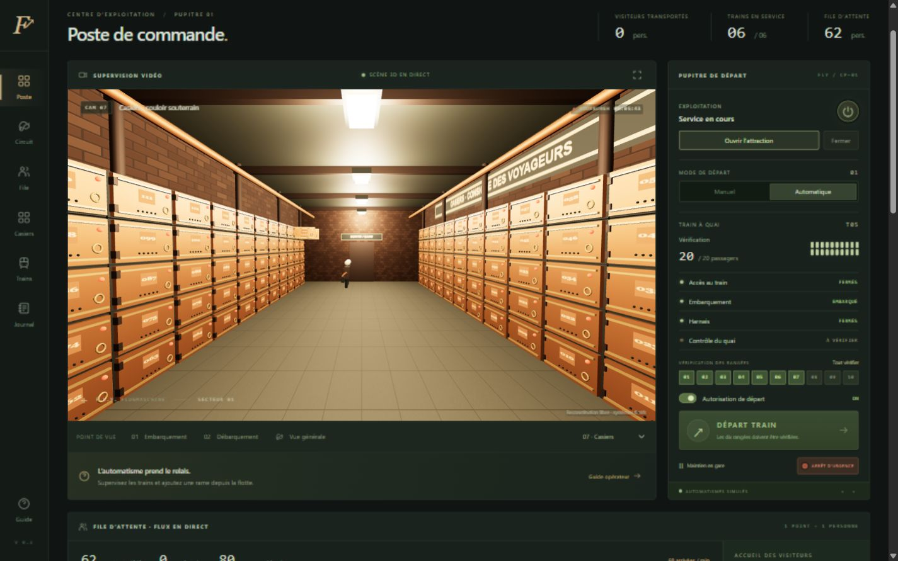
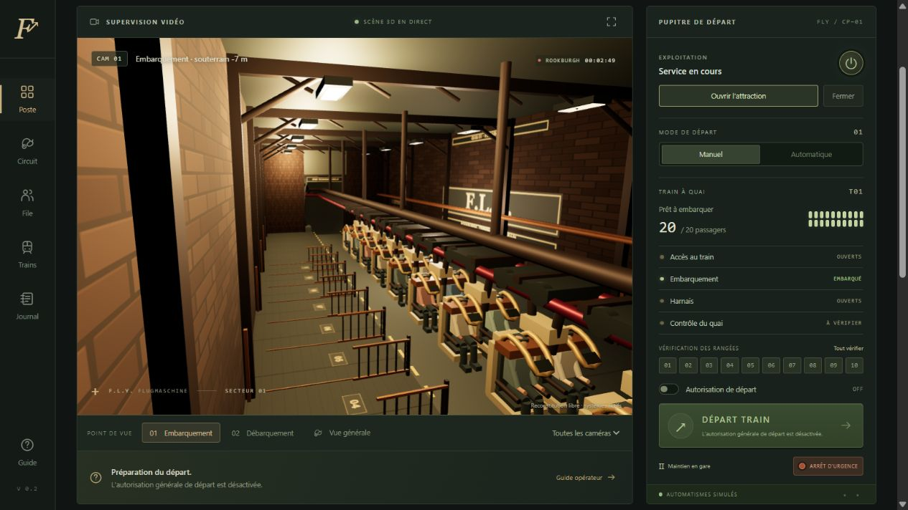
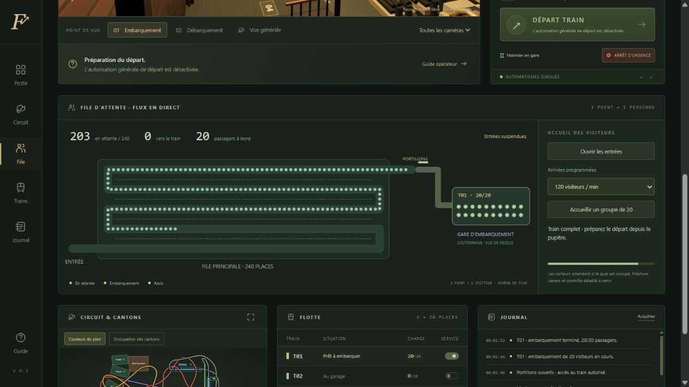

# F.L.Y. Operator Simulator

Prototype jouable 0.3 du cahier des charges V3 : scène Three.js à plusieurs niveaux, deux gares souterraines fermées, carte SVG issue du plan fourni, file d’attente 2D animée, 120 casiers et flotte de six trains. Le pupitre pilote un moteur indépendant du rendu.

Projet non officiel, sans affiliation à Phantasialand ni à Vekoma. Le circuit, les cantons, les capteurs, les séquences et les procédures sont des conventions fictives de jeu. Ce logiciel ne décrit pas les systèmes techniques réels et ne constitue pas un outil de formation à l'exploitation d'une attraction.

Les trois références fournies sont conservées dans `docs/references`. Le plan aérien sert au positionnement des gares, des parcours et des bâtiments. Les photos guident les matériaux industriels. Les altitudes, l’échelle, les courbes intermédiaires et les liaisons noires restent des hypothèses de reconstruction ; le plan seul ne permet pas de les mesurer. Le garage est une implantation fictive.

## Installation sous Windows

Installer Node.js 22 LTS ou supérieur (minimum : 20.19), puis ouvrir PowerShell dans le dossier du projet :

```powershell
npm install
npm run dev
```

Ouvrir l'adresse locale indiquée par Vite dans Chrome ou Edge. Aucune connexion à un serveur métier n'est nécessaire pour jouer.

```powershell
npm run test
npm run build
npm run preview
```

`test` exécute les tests Vitest, `build` produit les fichiers statiques dans `dist`, et `preview` sert localement ce résultat. Le rendu 3D nécessite WebGL.

## Portée de cette livraison

Les contrôles de gare, le mode automatique, les statistiques, la sauvegarde et la file 2D sont fonctionnels. Ce prototype ne constitue pas la réalisation complète des phases 2 à 6 du cahier des charges.

La simulation prévoit six trains, vingt places par train et dix rangées. T01 rejoint la gare après initialisation ; T02 à T06 commencent au garage. Le moteur contrôle les occupations et les réservations de cantons, l'arrivée au quai, le départ, le parcours, le débarquement puis le retour à l'embarquement.

### Premier départ en mode manuel

1. Appuyer sur le bouton rond d'initialisation, puis sur **Ouvrir l’attraction**.
2. Attendre environ 30 secondes : T01 passe par le débarquement, rejoint le quai d’embarquement et s’immobilise.
3. Cliquer sur **Accès au train** pour ouvrir les portillons, puis sur **Embarquement**. Attendre la fin des six secondes d'embarquement.
4. Refermer les accès et cliquer sur **Harnais** pour les fermer.
5. Vérifier les dix rangées une à une ou avec **Tout vérifier**, puis cliquer sur **Contrôle du quai**.
6. Activer **Autorisation de départ**, puis cliquer sur **Départ train**. Le train part réellement dans la scène et sur la carte.
7. Le débarquement et le transfert se déroulent automatiquement après le parcours ; préparer ensuite le départ suivant.

Les boutons affichent la raison d'un refus. Une vérification de rangée peut être annulée en la recliquant. Rouvrir les harnais invalide les vérifications. Un départ à vide reste possible pour un essai, avec les mêmes contrôles.

### Exploitation automatique et flotte

Après initialisation et ouverture, sélectionner **Automatique**, puis activer **Autorisation de départ**. Le moteur effectue progressivement les mêmes commandes que le joueur. Le mode manuel ne déclenche jamais de départ tout seul.

Cliquer sur **Mettre la flotte en service** pour demander les six trains. Les insertions se font progressivement lorsque le transfert se libère. Les interrupteurs individuels permettent aussi de demander ou d’annuler une insertion. Un retrait demandé attend le prochain débarquement complet ; un train vide déjà au quai peut être garé immédiatement. Les trains peuvent attendre un canton occupé sans se superposer logiquement. Cette flotte de jeu ne prétend pas représenter la capacité d’exploitation réelle de F.L.Y.

**Maintien en gare** suspend les départs. **Arrêt d’urgence** arrête immédiatement les mouvements dans cette simulation fictive. Pour reprendre, cliquer sur **Acquitter l’arrêt d’urgence**, puis **Réarmer après arrêt**, et réactiver l'autorisation de départ.

### Vues et sauvegardes

- Sept caméras : embarquement, débarquement, deux lancements, garage, vue générale et couloir des casiers. Glisser dans la scène pour tourner ; utiliser la molette pour zoomer.
- Carte SVG interactive : cliquer sur un canton pour voir son état, ou sur un train pour afficher sa charge et choisir sa caméra. Les coordonnées des deux rendus proviennent du même module géométrique.
- Bouton de sauvegarde dans la barre supérieure ; sauvegarde automatique IndexedDB toutes les 30 secondes après initialisation. Les paramètres permettent de restaurer la partie et de recommencer avec confirmation.
- La restauration contrôle notamment l'exclusivité, les réservations, les états de gare et la conservation des visiteurs avant de remplacer la partie.
- La simulation avance à vitesse réelle lorsque l'onglet est visible. Un onglet masqué suspend le service et déclenche une sauvegarde. Aucune progression hors ligne.
- Qualité faible, moyenne ou élevée dans les paramètres. Aucun téléchargement de modèles ni service externe n'est nécessaire après l'installation.

### File d’attente 2D

Cliquer sur **File** dans la navigation. Chaque point bleu correspond à une personne comptabilisée dans la file, chaque point doré à une personne en cours d’embarquement. Les vingt sièges du schéma se remplissent en même temps que le train du moteur.

- Choisir 0, 30, 60 ou 120 arrivées par minute, ou accueillir un groupe de 20.
- **Suspendre les entrées** interrompt les arrivées ; les visiteurs présents peuvent toujours embarquer.
- La capacité est de 240 personnes en attente. Un groupe ne dépasse jamais la place disponible.
- Les visiteurs progressent dans l’ordre d’arrivée et quittent la file au chargement du train. Les compteurs restent conservés pendant l’embarquement, le parcours et le débarquement.
- Les réglages et les compteurs sont sauvegardés. Les anciennes sauvegardes du prototype 0.1 sont validées puis migrées.

Les points distinguent maintenant l’attente, le dépôt, les visiteurs prêts et les casiers en défaut. La préparation aux casiers reste incluse dans le compteur de file : aucun visiteur n’est compté deux fois. Le zigzag est un schéma de flux, pas une reconstitution du cheminement réel. Le préshow et le contrôle individuel restent à développer.

### Casiers et affaires personnelles

L’onglet **Casiers** supervise 120 casiers individuels numérotés. Un casier appartient exclusivement à un visiteur, depuis sa réservation jusqu’à la récupération de ses affaires après le débarquement. Le cycle est : réservation, porte ouverte pour le dépôt, stockage pendant le tour, récupération puis libération. Un visiteur ne peut embarquer qu’après avoir terminé son dépôt ; l’ordre de la file est conservé.

- Attribution automatique au premier casier libre ou choix simulé du visiteur ; attribution manuelle également possible depuis un casier sélectionné.
- Six dépôts simultanés et quarante visiteurs préparés au maximum ; constantes et durées dans `src/config/operations.js`.
- Simulation d’une porte bloquée et intervention pour la débloquer. La panne conserve le propriétaire et les affaires ; elle peut retenir la tête de la file ou retarder une récupération.
- **Voir les casiers en 3D** ouvre un couloir fermé avec portes animées, voyants et visiteurs. Sa disposition est fictive et ses matériaux s’inspirent de la photo fournie.
- La sauvegarde conserve les propriétaires, les cycles en cours, les incidents et les insertions de trains en attente. Les anciennes parties à quatre trains sont validées, puis migrées vers six trains avec reconstruction des attributions nécessaires.

### Gares, circuit et coordonnées

`src/config/track.js` définit le repère commun : X/Z pour le plan aérien, Y pour l’altitude. `WORLD_LEVELS` contient les hauteurs réglables dans le code : extérieur à 0 m, rails des gares à −7 m, quais à −10,6 m, plafonds à −2 m, galerie de retour à −16 m et points hauts à +29 m. Ces valeurs sont des choix de mise en scène. La fonction `createTrack` permet de reconstruire le parcours avec d’autres altitudes sans déplacer les repères du plan.

Les deux stations occupent les traits cyan du plan : embarquement sur le trait vertical à droite, débarquement sur le trait horizontal supérieur. Cette affectation interprète les annotations ambiguës du document et pourra être ajustée. Chaque gare possède un plafond opaque, des murs avec portails de passage, des quais, une charpente, des lampes et une caméra intérieure. Les rampes rejoignent l’extérieur par des trémies ; le train suit une courbe continue en trois dimensions, partagée avec la carte.

La carte sépare **Couleurs du plan** et **Occupation des cantons**. Les couleurs du document ne définissent pas les cantons du moteur. Les connexions incertaines apparaissent en pointillés gris ; la montée motorisée est distinguée en vert. Les parcours rouge et orange et les deux lancements violets suivent une reconstruction approximative de leurs projections. Les croisements, la dynamique et les gabarits ne sont pas une étude d’ingénierie du circuit réel.

### Fichiers et architecture

```text
src/
  core/       SimulationEngine, SimulationClock, StateMachine, EventBus, CommandDispatcher
  config/     Tracé, capacités, durées et limites configurables
  systems/    Trains, cantons, gares, visiteurs, LockerSystem et statistiques
  rendering/  ThreeRenderer, TrainRenderer, TrackRenderer, TrackGeometry, Map2DRenderer, Queue2DRenderer
  scenes/     Décor industriel, gares, galeries souterraines et LockerRoom
  ui/         Pupitre, LockerPanel, tableaux, guide, paramètres et journal
  services/   Sauvegardes IndexedDB
  styles/     Interface responsive
  tests/      Tests Vitest
```

`index.html`, `package.json` et `vite.config.js` définissent l'application locale. `src/main.js` relie l'interface, les deux rendus et le moteur. Tous les boutons d'exploitation passent par `CommandDispatcher`. Le moteur ne dépend ni du DOM ni de Three.js. Il avance par pas fixes de 100 ms avec accumulateur ; les rendus lisent son état sans le modifier.

### Validation du prototype 0.3

93 tests Vitest couvrent les cantons et réservations, les autorisations, les modes manuel/automatique, six trains pendant vingt minutes virtuelles, l’arrêt d’urgence, les sauvegardes et la conservation des visiteurs. Ils vérifient aussi les casiers saturés, l’exclusivité des propriétaires, les portes bloquées, la récupération des affaires, la reprise en plein embarquement, les débits d’arrivée, les identités FIFO, les migrations, les positions des gares, la continuité de la boucle, les altitudes et l’occlusion des caméras par les murs et les plafonds.

La construction de production est vérifiée avec Vite. Cette livraison n'établit pas de mesure garantie à 60 FPS : les performances dépendent de la machine et du navigateur.

La vérification visuelle utilise le navigateur intégré Chromium. Chrome et Edge ne sont pas vérifiés séparément. Les captures ci-dessous montrent le prototype ; elles ne sont pas des photographies de l’attraction.

La version 0.3 a également été contrôlée sur des largeurs de 1440 et 390 pixels : six trains en service, blocage puis réparation d’un casier, changement du mode d’attribution et restauration de sauvegarde. Aucune erreur de console observée. Vite signale seulement la taille du module Three.js (environ 516 ko avant compression).









## À développer dans les phases suivantes

- **Phase 2 — Gares :** mise en scène détaillée des visiteurs, opérateurs, animations et procédures des deux gares.
- **Phase 3 — Circuit :** affiner les raccords et les hauteurs avec des références supplémentaires, enrichir le décor, le matériel roulant et les mouvements de sièges.
- **Phase 4 — Visiteurs :** préshow fonctionnel, contrôle de sécurité et cheminements détaillés entre les zones.
- **Phase 5 — Maintenance :** catalogue d'incidents, diagnostic guidé, actions de réparation et historique complet.
- **Phase 6 — Finalisation :** audio, tableaux statistiques complets, réglages et adaptation de qualité, optimisation, accessibilité et validation sur plusieurs machines.

Les tests de cette livraison portent sur les systèmes réellement implémentés. Le préshow et les diagnostics avancés restent à créer.
