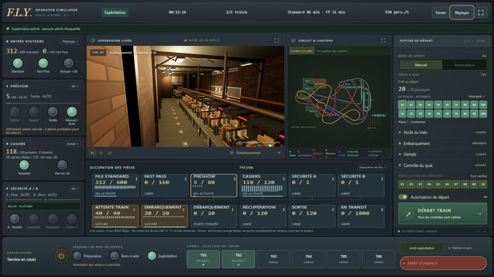

# Validation — pupitre 0.5

## Vérifications exécutées

- **131 tests Vitest réussis**, répartis sur onze fichiers. La suite comprend les tests existants du moteur, des cantons, du circuit, des gares souterraines et des sauvegardes, ainsi que les scénarios des files, préshow, casiers, sécurité, retenues et maintenance déjà intégrée.
- Cycle réel du moteur : initialisation → Préparation → Tests à vide de chaque train → ouverture visiteurs → embarquement → départ → retour et récupération.
- Les six trains accomplissent leurs tests sans bloquer la boucle. Les scénarios d’endurance exploitent les deux files et six trains pendant trente minutes simulées.
- Transferts garage animés, occupation exclusive du transfert, section conservée pendant le retrait, annulation des demandes et retrait après débarquement.
- Quarante secondes d’entrées engagées pour un lot de quatre-vingts visiteurs à deux personnes/seconde, hors ouverture de porte et trajet.
- Réservations de places à destination, saturation aval, fermeture pendant un passage, retours de sécurité dans la même identité et le même casier. Deux places de la pièce casiers sont protégées pour ces retours.
- Départ refusé si portique ouvert, retenue invalide, quai non contrôlé ou section suivante indisponible. Rouvrir un harnais annule sa validation.
- L’acquittement ne résout pas un défaut critique. La maintenance doit le résoudre avant le réarmement ; le réarmement ne rend pas automatiquement l’autorisation de départ.
- Sauvegardes atomiques et déterministes, y compris pendant un transit et un embarquement partiel ; migrations des anciennes versions vers la version de données 5.

## Vérification dans le navigateur intégré

Les contrôles ont été réalisés à **1920×1080**, **1536×864** et **1366×768**. À chaque résolution, la largeur et la hauteur défilables du document correspondent à celles du viewport. Les commandes principales sont dans l’écran et les boutons de la colonne gauche restent à l’intérieur de leur panneau.

Le test manuel dans l’interface a effectué : tests à vide de deux trains, ouverture de l’exploitation, ajout Fast Pass, restauration d’une partie, arrivée du train, ouverture des portiques, embarquement de vingt personnes, fermeture des portiques avant la fin des passages, validation des retenues et du quai, puis départ autorisé à vingt passagers. Les vues 3D, le circuit SVG et le plan des pièces restent présents simultanément. Les journaux de console contrôlés ne contiennent aucune erreur ni avertissement de fonctionnement.

Captures :

- [1920×1080](pupitre-1920x1080.jpg)
- [1536×864](pupitre-1536x864.jpg)
- [1366×768](pupitre-1366x768.jpg)

## Compilation et chemins Pages

La compilation locale Vite et une seconde compilation avec `GITHUB_ACTIONS=true` et `GITHUB_REPOSITORY=mathieugirardin-cmd/fly-operator-simulator` ont réussi. Le préfixe généré est `/fly-operator-simulator/`.

Les quatre ressources référencées par l’HTML compilé existent et répondent en HTTP 200 sous ce préfixe. Les assets examinés ne contiennent pas de chemin Windows ni de référence au serveur de développement. Le jeu compilé démarre également dans le navigateur sous ce préfixe : neuf caméras, douze zones d’occupation, vingt places, rendu WebGL et initialisation opérationnelle.

Le fichier npm verrouillé a été généré et une installation propre `npm ci` a réussi dans un dossier temporaire. Les résultats du déploiement distant sont disponibles dans [GitHub Actions](https://github.com/mathieugirardin-cmd/fly-operator-simulator/actions/workflows/deploy.yml) ; les contrôles locaux ci-dessus ne remplacent pas ce résultat.

## Limites précises

- Le contrôle du plein écran natif reste partiel dans l’hôte intégré : l’inspection du panneau a signalé l’état CSS `:fullscreen`, mais le retour hors de cet état n’a pas été confirmé après le second clic. Le cycle entrée/sortie reste à vérifier dans Chrome/Edge hors navigateur intégré. Le bouton prévoit un message d’alternative F11 si l’API est refusée.
- Chrome et Edge n’ont pas été testés séparément ; les contrôles visuels utilisent Chromium intégré.
- Vite avertit que le module Three.js dépasse 500 ko avant compression (environ 516 ko). La compilation réussit ; aucune garantie de 60 FPS n’est établie sur les différents ordinateurs.
- Les nouveaux incidents complexes et la refonte des statistiques sont reportés, conformément au dernier complément. Le catalogue et les contrôles déjà présents restent accessibles dans le tiroir.
